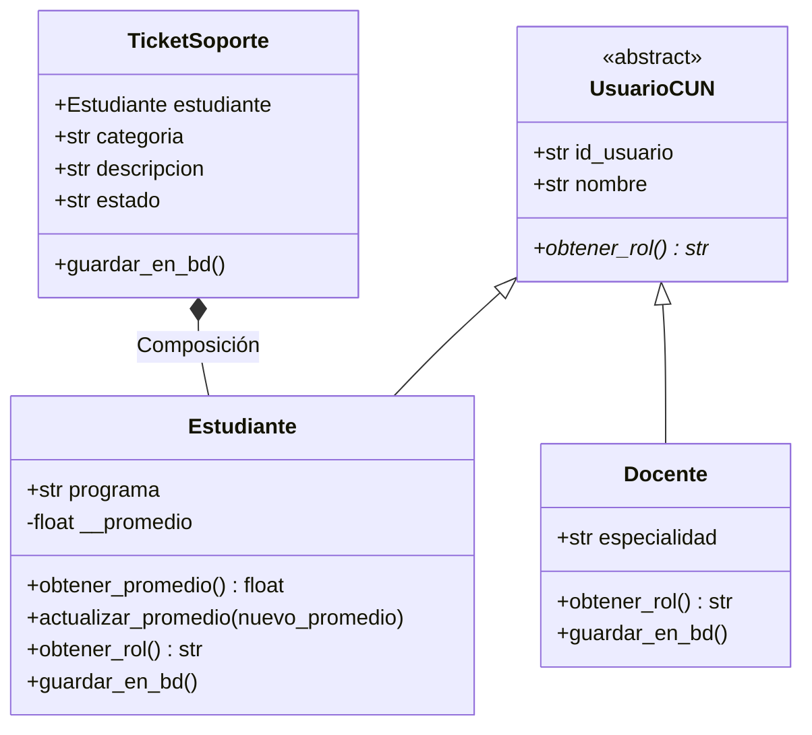
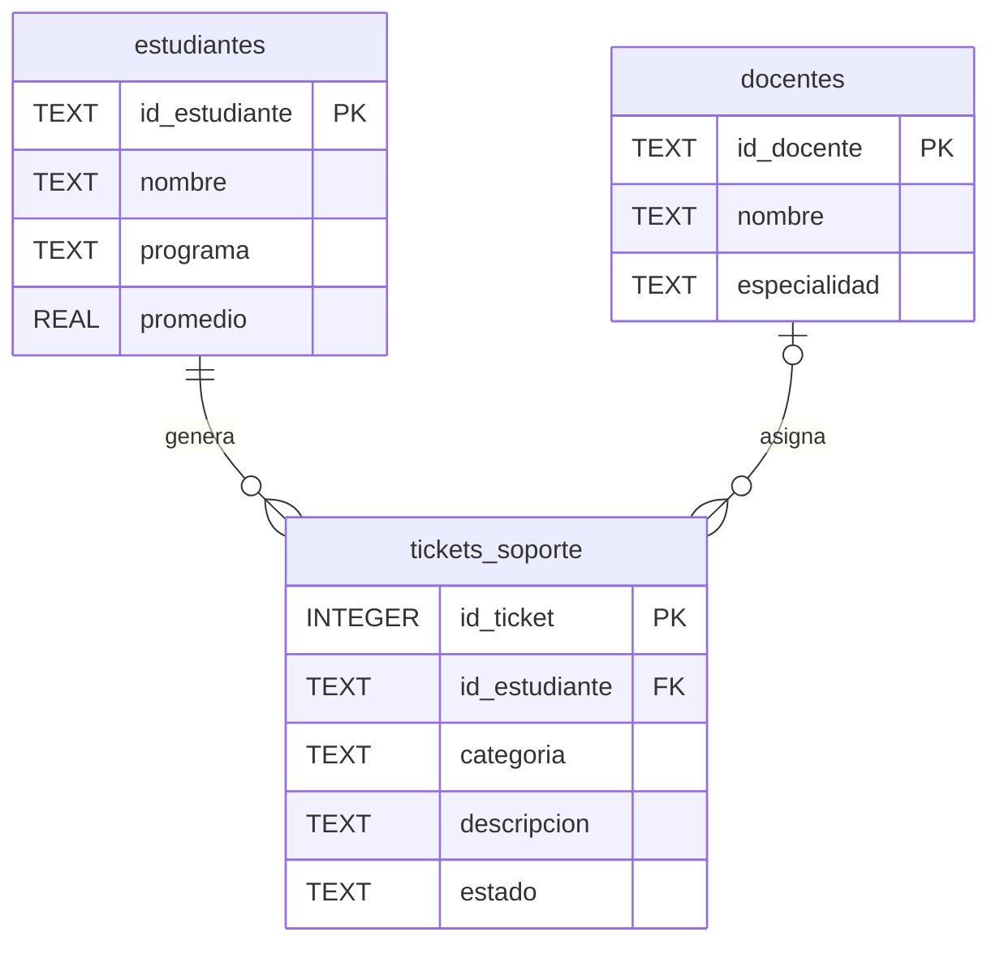

# 🛠️ Sistema Integrador de Gestión Académica y Soporte TI – CUN

Proyecto práctico y evaluación de **Programación Orientada a Objetos (POO)**  
*Corporación Unificada Nacional de Educación Superior (CUN)* — **Ingeniería de Sistemas**

Sistema de consola y módulo de persistencia desarrollado en **Python 3** y **SQLite**, diseñado para automatizar la gestión de estudiantes, docentes y el flujo de atención de solicitudes técnicas (tickets de soporte TI).

---

## 📌 Descripción y Caso de Estudio

La Mesa de Ayuda TI de la CUN requiere un sistema que centralice las solicitudes de soporte técnico académico y vinculación con la comunidad universitaria. El sistema gestiona las entidades de **Estudiantes**, **Docentes** y **Tickets de Soporte TI**, aplicando reglas de negocio como la validación de promedios académicos y la gestión de estados de los tickets.

---

## 🎯 Objetivos Desarrollados

- [x] **Modelado POO:** Diseño de entidades aplicando **Abstracción**, **Herencia**, **Encapsulamiento** y **Composición**.
- [x] **Persistencia de Datos:** Construcción e interacción automatizada con la base de datos relacional `cun_sistema.db` mediante el módulo `sqlite3`.
- [x] **Control de Excepciones:** Validación estricta de entradas (rango de notas $0.0 \le \text{promedio} \le 5.0$, campos obligatorios y claves primarias).
- [x] **Control de Versiones:** Repositorio en GitHub estructurado según la guía docente institucional.

---

## 🧠 Arquitectura de Software y Pilares POO

| Pilar POO | Aplicación en el Proyecto |
| :--- | :--- |
| **Abstracción** | Definición de la clase abstracta base `UsuarioCUN` utilizando el módulo `abc` (`ABC`, `@abstractmethod`). |
| **Herencia** | Clases `Estudiante` y `Docente` heredan los atributos base de `UsuarioCUN` reutilizando `super().__init__()`. |
| **Encapsulamiento** | Atributos privados como `__promedio` protegidos contra modificaciones no autorizadas mediante getters y setters con validación. |
| **Polimorfismo** | Sobrescritura del método `obtener_rol()` según la entidad (`Estudiante` vs. `Docente`). |
| **Composición** | La entidad `TicketSoporte` requiere de un objeto de tipo `Estudiante` para ser instanciado y registrado. |

### Diagrama de Clases (UML)



---

## 🗄️ Esquema Relacional de Base de Datos (`cun_sistema.db`)



---

## 📁 Estructura del Repositorio

```text
taller-poo-cun/
├── main.py            # Lógica POO, conexión a SQLite y pruebas de ejecución
├── cun_sistema.db     # Base de datos relacional (generada al ejecutar main.py)
├── .gitignore         # Configuración de exclusiones para Git
└── README.md          # Documentación del proyecto
```

---

## 🚀 Instrucciones de Ejecución

### 1. Clonar el repositorio
```bash
git clone https://github.com/JUanchotoi1/taller-poo-cun.git
cd taller-poo-cun
```

### 2. Ejecutar la aplicación
El proyecto no requiere librerías externas. Únicamente se requiere contar con **Python 3.8+** instalado.

```bash
python main.py
```

Al ejecutarse, el sistema:
1. Crea de forma implícita la base de datos `cun_sistema.db` y sus tablas si no existen.
2. Realiza inserciones de prueba para estudiantes y tickets de soporte.
3. Ejecuta las comprobaciones de validación de promedios académicos y manejo de excepciones.

---

## 📦 Entregables Cumplidos

- [x] Código fuente en Python (`main.py`) comentado y funcional.
- [x] Base de datos relacional SQLite generada localmente.
- [x] Publicación y control de versiones en GitHub.

---

## 👤 Información del Autor

- **Usuario GitHub:** [@JUanchotoi1](https://github.com/JUanchotoi1)
- **Programa:** Ingeniería de Sistemas
- **Institución:** Corporación Unificada Nacional de Educación Superior (CUN)
- **Asignatura:** Programación Orientada a Objetos (POO)